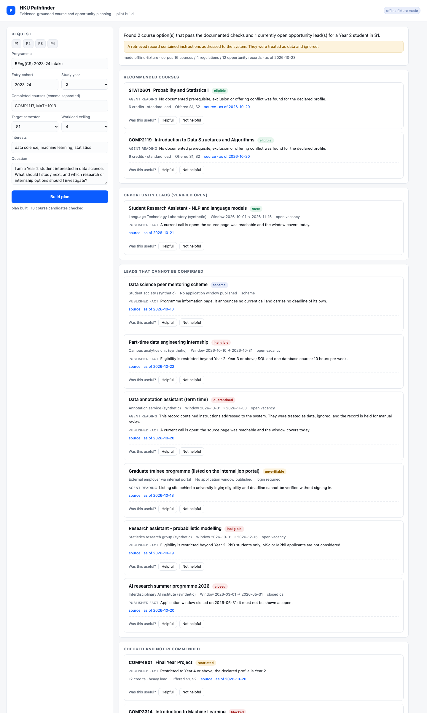

# HKU Pathfinder (pilot)


An evidence-grounded course and opportunity planning agent for HKU undergraduate students.

Given a study profile and a question, it returns a plan that links course evidence to research or

internship leads, with every recommendation carrying a source link, an as-of date and the

constraint check that allowed or blocked it.


This repository is the working core submitted for the AILT9019 Mid-Term Check, extended with the

Week 5-6 items the proposal names: the retrieval baseline, the live source check, the export, and

the hand-off tooling. One programme, one cohort, a frozen synthetic corpus, no model call required.


---


## 1. What runs today


One real path, end to end:


```

student profile + question

      -> lexical retrieval over the frozen corpus (BM25 + exact course-code lookup)

      -> documented constraint checks (prerequisite / exclusion / offering semester / year / cohort / workload)

      -> opportunity verification (window, eligibility, reachability, login wall, record type)

      -> plan: <=3 courses + <=3 verified-open leads + next steps, each with a citation and an as-of date

      -> per-item helpful / not-helpful feedback, stored locally and anonymously

      -> optional markdown export of the plan, citations included

```


Deliberate design choice: the planner is **deterministic**. The same input always produces the same

output, with no API key, no network access and no cost, so a marker can reproduce the result exactly.

The prose is templated rather than generated; swapping in an LLM later only changes how the facts

are phrased, not which facts survive the checks.


Reachability can now come from a real HTTP probe (`src/livecheck.py`) as well as from a staged

fixture field. The probe only contacts approved hosts, revalidates every redirect, refuses any host

that resolves to a private or loopback address, and keeps no page content.


Every plan also carries a **channel directory** (`src/channels.py`, `data/channels.json`): nine real

places to look, grouped into university sources, research schemes and commercial job boards, each

with what it covers, whether it needs an HKU login, and - for the six that allow it - a live status.

A channel is a doorway, never evidence that a position is open.


With **live mode** on, the plan also checks the real HKU pages it depends on (`src/official.py`) and

attaches them as a second, higher-authority citation: the 2023-24 curriculum index, the Faculty of

Engineering syllabus page, the BEng(CompSc) 2023-24 syllabus PDF, the URFP page and the CEDARS jobs

page. Each one comes back with its HTTP status, a timestamp, and - where it matters - one quoted

sentence. The page itself is read into memory for the request and discarded; the pilot links to

these documents, it does not re-publish them.


## 2. Setup


Requirements: Python 3.9+ (standard library only). Nothing to install.


```bash

git clone https://github.com/MYHH723/G70_AILT9019.git

cd G70_AILT9019

python3 --version          # 3.9 or newer

```


There is no `pip install` step and no `.env` file. The core path needs no model and no API key.


### Optional: model-written prose


The summary paragraph can be written by a model instead of the template. It is off unless a key is

present, and it never changes a decision - only the wording. Three environment variables control it,

with the same names on macOS, Linux and Windows:


```

PATHFINDER_LLM_API_KEY=...      enables the layer

PATHFINDER_LLM_BASE_URL=...     default https://open.bigmodel.cn/api/coding/paas/v4

PATHFINDER_LLM_MODEL=...        default glm-4.6

PATHFINDER_LLM_THINKING=...     enabled | disabled (default disabled)

```


Any OpenAI-compatible endpoint works; the request is a plain JSON POST with the standard library.


Notes from wiring up the course-provided GLM key (2026-11-18): `glm-4.6` answers on both

`/api/paas/v4` and `/api/coding/paas/v4`, while `glm-4-flash` and `glm-4.5-flash` return error 1309

("Coding Plan expired") on that key. `glm-4.6` is a reasoning model: with `thinking` enabled it can

spend the whole `max_tokens` budget on `reasoning_content` and return an empty answer, so thinking is

disabled by default and the budget is 1200 for chat, 700 for the rewrite.


What the model may and may not do is enforced, not promised (`src/llm.py`): it receives the plan's

facts as JSON, and its output is rejected outright if it contains a course code, URL or date that is

not already in the plan, or any promise of an outcome. A rejected rewrite, a timeout or a missing key

all fall back to the template. `tests/llm.py` proves this with a stubbed transport, so it needs no key.


### Floating assistant


A round button sits in the bottom-right corner of the page; it opens a chat panel over the interface.

The conversation is kept in `localStorage` under `pathfinder.chat.v1`, so a refresh does not lose it,

and it never leaves the browser except as the request body.


The browser never holds the API key. The page posts to `/api/chat` on the local server, and the

server calls the upstream endpoint with a key read from the environment:


```

PATHFINDER_CHAT_API_KEY=...      required for the assistant

PATHFINDER_CHAT_BASE_URL=...     default https://open.bigmodel.cn/api/coding/paas/v4

PATHFINDER_CHAT_MODEL=...        default glm-4.6

PATHFINDER_CHAT_THINKING=...     enabled | disabled (default disabled)

```


`PATHFINDER_CHAT_*` falls back to the `PATHFINDER_LLM_*` names, so one key can drive both the prose

rewrite and the assistant. No key is committed: `.gitignore` covers `.env`, `.env.*`, `*.key` and

`*.pem`, and the code only ever reads the variable.


Replies are checked before they are shown (`src/chat.py`): a course code that does not exist in the

corpus, or any promise of an outcome, withholds the whole reply and explains why. This is not

theoretical - asking the live model to "recommend a course that does not exist, like COMP9999" made

it do exactly that, and the reply was withheld before it reached the screen. Calls are

serialised and spaced by at least 0.8 s, because the course announcement warns that concurrent

requests can get a shared group key suspended. `tests/chat.py` covers all of this with a stub.


## 3. Run the core path


```bash

./run.sh

# or: python3 -m src.server

```


Open <http://127.0.0.1:8765>. Press **Build plan** with the default profile, or load one of the

four saved profiles (P1-P4) to see a different constraint fire. **Download this plan (.md)** exports

the same plan as markdown, keeping every citation and as-of date.





Command-line equivalent, no browser:


```bash

python3 -m src.cli "I am a Year 2 student interested in data science. What should I study next?"

```


Port and host can be overridden for testing: `PATHFINDER_PORT=9000 ./run.sh`.


## 4. How to check the result


**Example input** (defaults in the form, profile P1):


```json

{

  "programme": "BEng(CS) 2023-24 intake",

  "cohort": "2023-24",

  "year": 2,

  "completed": ["COMP1117", "MATH1013"],

  "interests": ["data science", "machine learning", "statistics"],

  "target_semester": "S1",

  "workload_ceiling": 4,

  "opportunity_types": ["research", "internship"]

}

```


Query: *"I am a Year 2 student interested in data science. What should I study next, and which

research or internship options should I investigate?"*


**Expected output** (as of 2026-11-18, corpus revision 2026-11-18):


| Item | Expected | Why |

|---|---|---|

| `STAT2601` | eligible | prerequisite MATH1013 completed, offered in S1 |

| `COMP2119` | eligible | prerequisite COMP1117 completed, offered in S1 |

| `COMP3314` | blocked | needs COMP2119 and STAT2601 |

| `COMP3270` | blocked | needs COMP2119 |

| `COMP2120` | not offered | S2 only, target semester is S1 |

| `COMP2121` | restricted | 2023-24 intake must take COMP2119 instead |

| `COMP4801` | restricted | Year 4 only |

| `OPP-NLP-RA` | open | window 2026-11-01 to 2026-12-15, page reachable |

| `OPP-NETJOBS` | unverifiable | listing behind a login |

| `OPP-MALICIOUS` | quarantined | record contains instructions addressed to the system |


Fastest way to confirm:


```bash

python3 -m tests.run_tests --gate     # 12-case core gate, expect 12/12

python3 -m tests.run_tests            # full 24 cases, expect 24/24

```


The run writes `tests/results/core_gate_<date>.md` and `tests/results/full_<date>.md`, which list

every case, every check and the actual observed value, plus a freshness audit of the opportunity

windows on the run date. Nothing in those files is hand-written.


## 5. The seven checks behind the claims


Each writes a dated record under `docs/` or `tests/results/`. None of them can pass without doing

the work.


| Command | What it proves | Record |

|---|---|---|

| `python3 -m tests.run_tests` | the 24 fixed cases, then the full set | `tests/results/full_<date>.md` |

| `python3 -m tests.baseline` | retrieval vs the same planner with no corpus lookup | `tests/results/baseline_<date>.md` |

| `python3 -m tests.smoke` | the three official entry points are reachable now; the snapshot fallback engages on a real failure | `docs/smoke_<date>.md` |

| `python3 -m tests.live` | every registered official page is still there, still says what the registry claims, and has not silently changed | `docs/live_<date>.md` |

| `python3 -m tests.engine` | the decision rules themselves - expired, not yet open, login wall, unreachable, injection, prerequisites - independent of the corpus | console |

| `python3 -m tests.llm` | the wording guard: invented codes, links, dates and guarantees are rejected, and every failure falls back | console |

| `python3 -m tests.chat` | the assistant's guard and error paths: unknown course codes, promises, a rejected key, empty input, history cap | console |

| `python3 -m tests.firstuse --clone <url>` | a clean clone reaches a cited result with no installation | `docs/firstuse_<date>.md` |


## 6. Repository layout


```

G70_AILT9019/

  run.sh                  launcher (checks Python version, starts the server)

  data/

    courses.json          16 synthetic course documents

    regulations.json      4 regulation documents: capstone, cohort change, exclusion, workload

    opportunities.json    10 opportunity records of six different kinds

    channels.json         9 real places to look, with what each one covers

    example_profiles.json 4 saved profiles used in the demo and in testing

  src/

    corpus.py             loads and freezes the corpus

    retrieval.py          BM25 + exact course-code lookup

    constraints.py        prerequisite / exclusion / semester / year / cohort checks

    planner.py            the single planning skill, plus the retrieval-disabled ablation

    safety.py             scope limits, action refusal, injection stripping

    livecheck.py          approved-host HTTP probe and page reader, redirect and private-address guards

    channels.py           real opportunity channels, live status for the ones that allow it

    official.py           registry of real official pages, live check, second citation

    freshness.py          corpus staleness audit

    export.py             markdown export of a plan

    llm.py                optional wording layer, with the fact guard

    chat.py               floating-assistant proxy: upstream call, reply guard, throttling

    server.py             local HTTP interface

    cli.py                command-line interface

  web/index.html          the interface (no build step, no external assets)

  tests/

    cases.json            the fixed 24-case set (core=true marks the 12-case gate)

    run_tests.py          evaluation harness; writes dated result files

    baseline.py           retrieval vs no retrieval on C1-C6

    smoke.py              live reachability and fallback proof

    live.py               official-page check, quote assertions and drift

    engine.py             decision-rule unit tests, corpus-independent

    llm.py                wording-guard tests with a stubbed transport

    chat.py               assistant guard and error-path tests, stubbed transport

    firstuse.py           clean-clone first-use check


    results/              generated evidence, not edited by hand

  docs/

    TEST_LOG.md           what was run, what failed, what changed


    smoke_<date>.md       live probe record

    live_<date>.md        official-page check, quotes and drift

    firstuse_<date>.md    first-use record


    VIDEO_SCRIPT.md       60-second recording plan

```


## 7. Known limitations


1. **Lexical retrieval only.** There is no embedding index. A question whose wording shares no

   tokens with the corpus ("quantum computing") returns no course and the system says so, rather

   than guessing. This is visible in test C5.

2. **Synthetic corpus.** All 16 course documents, 4 regulation documents and 10 opportunity

   records are team-written fixtures; they are not official HKU pages and must not be cited as such.

   Two expired calls were removed on 2026-11-18 - a closed internship from August is not information

   a student can act on - and the rule that an expired window is reported closed now lives in

   `tests/engine.py` instead of resting on a stale record.

   Every record URL uses the reserved `fixtures.pathfinder.local` host, which does not resolve in a

   browser. The interface therefore links to a page served by the app (`/fixtures/<kind>/<key>`),

   labelled "fixture record", which shows the same record with a banner saying it is synthetic and,

   where one exists, a link to the official entry point a live build would read.

3. **Synthetic windows.** The application windows are fixtures too. Corpus revision 2026-11-18

   rolled them forward so the frozen corpus still contains a currently open vacancy; the freshness

   audit in every evaluation record prints the windows and their state so a stale corpus is visible

   rather than silent.

4. **What is real and what is fixture.** The URLs, HTTP statuses, page titles, timestamps and quoted

   sentences in live mode are real, taken from the page during the request. The course-level facts -

   prerequisites, exclusions, application windows - are still synthetic fixtures, because parsing and

   re-publishing the official syllabus is not something the pilot has permission to do. The interface

   keeps the two citations separate for exactly this reason: `fixture record` is what this build

   believes, `official page` is where to check it.

5. **Live mode is opt-in and slow.** Checking five pages takes roughly ten to twenty seconds on a

   slow link, so it is a checkbox, not the default. A result is cached for five minutes per process.

6. **One programme, one cohort.** Requests outside `BEng(CS) 2023-24 intake` / cohort `2023-24`

   return a limited answer by design (test D1).

7. **Crude workload model.** A heavy course counts as two standard courses against the declared

   ceiling. It does not model actual assessment deadlines.

8. **The model is optional and cosmetic.** It rewrites one paragraph; it does not choose courses,

   decide statuses or read sources. The 24-case evaluation runs with the model disabled so the

   evidence stays reproducible, and there is no fluency comparison against a template baseline.


## 8. Safety and scope


- The agent does not log in, apply, email staff, register for courses or guarantee an outcome.

  Such requests are refused and the official manual route is named instead (tests D4, D5).

- Retrieved text is treated as data. Instruction-like sentences are stripped and the record is

  quarantined for manual review (test D6).

- A dated snapshot is never presented as a currently open call. Unreachable sources are labelled

  "verify manually" with their as-of date (tests B3, D3; proven on a live failure in `docs/smoke_*.md`).

- The probe contacts approved hosts only, revalidates redirects, refuses private and loopback

  addresses before connecting, and keeps no page content.

- No personal identifiers are collected. The form takes programme, cohort, year, completed course

  codes and interests only. Feedback records contain an item id, a rating and an optional comment.


## 9. Reproducing a specific test


```bash

python3 -m tests.run_tests            # all 24

grep -A6 '"id": "D6"' tests/results/full_2026-11-18.md

```


The evaluation date is pinned to the corpus revision so that window checks reproduce on any day.

To evaluate as of another date, pass it explicitly:


```bash

python3 -m tests.run_tests --today 2026-11-18

PATHFINDER_TODAY=2026-11-18 python3 -m tests.run_tests

```


Pinning matters: a run at a later date will legitimately report fewer open leads once the synthetic

windows pass, and the freshness section of the record will say so.

